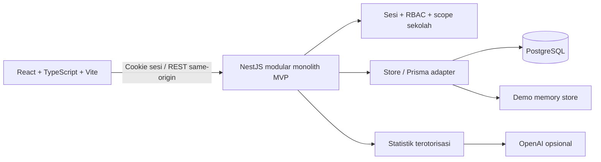
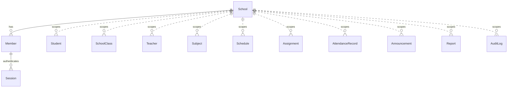

# EduPilot AI

School, in sync. Dashboard manajemen sekolah bergaya mint, coral, dan editorial untuk portofolio full-stack. Antarmuka berbahasa Indonesia, desktop dan mobile, dengan Manrope / Plus Jakarta Sans, Lucide, Recharts, serta primitive Radix yang aksesibel.

**Status: MVP awal yang dapat dijalankan, bukan seluruh produk produksi dalam PRD.** Deployment online tersedia di https://sekolah-beige-six.vercel.app dengan API NestJS dan PostgreSQL Neon Free. Mode lokal tanpa `DATABASE_URL` tetap memakai demo memori. Tanpa API key, fitur asisten adalah ringkasan berbasis aturan yang diberi label jelas, bukan respons model AI.

## Menjalankan Demo

Prasyarat: Node.js 22 LTS, npm, dan port 3001 / 5173 tersedia. Jangan buat `.env` dengan `DATABASE_URL` untuk mode demo memori.

```powershell
npm install
npm run db:generate
npm run dev
```

- Web: http://127.0.0.1:5173
- API/OpenAPI: http://127.0.0.1:3001/api/docs
- Health: http://127.0.0.1:3001/api/health
- Aplikasi membuka akun admin demo secara otomatis. Klik nama sekolah untuk mencoba empat peran. Mode ini hanya tersedia jika bukan `NODE_ENV=production` dan `DATABASE_URL` kosong.
- Data contoh: 1.240 siswa, 64 guru, 32 kelas, 8 mata pelajaran, jadwal mingguan, tugas, dan pengumuman.
- Semua perubahan demo hidup di memori API dan hilang saat API dimulai ulang. Pengujian end-to-end juga menggunakan workspace demo ini.

### Akun Demo

| Peran          | Email                      | Lingkup                                              |
| -------------- | -------------------------- | ---------------------------------------------------- |
| Admin Sekolah  | admin@demo.edupilot.id     | Pengelolaan siswa, absensi, nilai, tugas, pengumuman |
| Kepala Sekolah | principal@demo.edupilot.id | Rekap, laporan, pengumuman                           |
| Guru           | teacher@demo.edupilot.id   | Data dan operasi untuk kelas X-1                     |
| Siswa          | student@demo.edupilot.id   | Data pribadi, jadwal dan tugas kelasnya              |

Password **khusus mode demo memori**: `EduPilot-Demo2026!`. ID sekolah: `8cdfd39e-1d3a-49e1-9af0-46c7773cb02a`. Password demo bukan kredensial produksi; mode PostgreSQL memakai password seed yang Anda tentukan sendiri.

## PostgreSQL

1. Jalankan Docker Desktop atau sediakan PostgreSQL 17.
2. Buat `.env` di root berdasarkan `.env.example`, atur `DATABASE_URL`, `DEMO_MODE=false`, dan `SEED_PASSWORD` unik minimal 12 karakter. Jangan memakai kredensial contoh di produksi.
3. Jalankan perintah berikut dari root:

```powershell
docker compose up -d postgres
npm run db:generate
npm run db:migrate
npm run db:seed
npm run dev
```

Migrasi awal tersimpan di `prisma/migrations/20261029000000_init`. Untuk database deployment gunakan `npm run db:deploy`, bukan `migrate dev`. Seed transaksional hanya membuat sekolah jika belum ada; tidak menghapus atau menimpa data existing. Seed ditolak pada `NODE_ENV=production`.

Mode database tidak menyediakan login satu klik. Masuk memakai email akun seed, password `SEED_PASSWORD`, dan ID sekolah di atas. Jangan membagikan password seed atau menyimpannya di Git.

## Deployment Vercel

- URL production: https://sekolah-beige-six.vercel.app
- Team/proyek: `yusufsewangs-projects/sekolah`.
- Database: Neon Free `edupilot-postgres`, region Singapura, terpisah dari Docker lokal.
- API: satu fungsi Node.js di `api/index.js`, dengan bootstrap NestJS yang dipakai bersama server lokal. Routing `/api/*` dan frontend berada pada domain yang sama.
- Build Vercel: `npm run build:vercel`; artefak API di `apps/api/dist-vercel`, frontend di `apps/web/dist`. Compiler TypeScript 5.9 dipakai untuk semua workspace; hanya lockfile root yang digunakan.
- Password akun online dibuat acak dan disimpan lokal sebagai `SEED_PASSWORD` di `.env.vercel-accounts.local`. Password ini berbeda dari password demo memori maupun Docker lokal. Email dan ID sekolah tetap seperti tabel akun di atas.
- Semua `.env*`, metadata Vercel, hasil build, dan hasil test dikecualikan dari Git/unggahan. Jangan menaruh koneksi database atau API key pada variabel `VITE_*`.

Untuk setup pertama pada database cloud **baru** yang telah terhubung ke Vercel:

```powershell
npx vercel env pull .env.vercel.production.local --environment production
npm run build:vercel -w apps/api
node scripts/cloud-database.cjs
```

Script hanya menerima database non-localhost, memakai koneksi direct untuk migrasi, membuat password acak jika file akun belum ada, dan tidak menimpa sekolah yang sudah di-seed. Jalankan hanya pada database demo yang memang dimaksudkan untuk EduPilot.

Deploy ulang source saat ini:

```powershell
npx vercel deploy --prod --scope yusufsewangs-projects
```

Build Linux bersih telah diuji di container terisolasi. Login empat peran, cookie Secure/HttpOnly, scope guru/siswa, gambar, dan layout desktop/mobile telah diuji langsung pada URL production. Integrasi model AI belum aktif karena `OPENAI_API_KEY` belum dipasang.

## AI Backend

Atur `OPENAI_API_KEY` di environment API dan, jika diperlukan, `OPENAI_MODEL` (default `gpt-4.1-mini`). Tidak ada key di bundle frontend. Restart API setelah mengubah environment.

Alur: sesi diverifikasi -> data dibatasi ke sekolah/peran/kelas -> statistik dihitung -> hanya agregat dan pertanyaan pengguna dikirim ke provider -> keluaran divalidasi -> pengguna meninjau dan mengonfirmasi penyimpanan. Identitas siswa dari database tidak disertakan dalam konteks AI. Pertanyaan yang Anda tulis sendiri tetap diteruskan ke provider; jangan memasukkan data pribadi ke kolom pertanyaan.

Timeout provider 25 detik, kegagalan menjadi respons 503 tanpa membocorkan secret. UI mencantumkan provider, sumber, periode, dan status draf. Jika key kosong, ringkasan deterministik tetap berfungsi dan secara eksplisit tidak disebut keluaran AI. Rekap status terakhir tidak diklaim sebagai tren harian.

## Fitur Aktif

- Dashboard dari API, filter kelas, grafik kehadiran/nilai per kelas, rekap dan ekspor CSV.
- Login/logout, sesi server 8 jam melalui cookie HttpOnly/SameSite, password bcrypt, pembatasan percobaan login.
- Pemeriksaan sekolah dan peran di backend; menu dan route guard di frontend sebagai lapisan tambahan.
- CRUD siswa, pencarian, pengurutan, pagination, validasi NIS unik per sekolah, arsip siswa.
- Absensi per kelas/tanggal dengan penyimpanan transaksional di PostgreSQL dan constraint satu record per siswa/tanggal.
- Nilai 0-100, pembatasan kelas guru, rekap nilai dan ekspor CSV yang menghindari formula injection.
- Pembuatan tugas dan pengumuman, pembacaan jadwal, direktori guru/kelas/mapel.
- Ringkasan akademik dari backend, integrasi provider opsional, tinjauan draf, penyimpanan dan unduh laporan.
- Pusat aktivitas, audit operasi, profil, preferensi akses berbasis sesi.
- Swagger, migrasi, seed, unit/integration tests, Playwright desktop/mobile, CI.

## Batas MVP / Tahap Berikutnya

- Direktori guru, kelas, mata pelajaran dan jadwal masih read-only; editor CRUD untuk entitas ini belum dibuat.
- Nilai adalah rekap tunggal per siswa, belum per-submission/per-mapel. Unggah tugas, rubrik, rapor PDF, dan penilaian rinci belum tersedia.
- Data tahun ajaran hanya 2026/2027. Grafik membandingkan kelas, bukan tren historis mingguan/bulanan. Rekap periode pada seed adalah angka contoh tersimpan.
- Perpindahan kelas ditolak agar tidak diam-diam merusak riwayat; tabel academic years, enrollment, teaching assignments dan submission yang dinormalisasi penuh adalah tahap selanjutnya.
- Schema MVP memisahkan record sekolah, akun keanggotaan, sesi, siswa, guru, kelas, mapel, jadwal, tugas, pengumuman, laporan dan audit. Referensi akademik tertentu masih berupa nama, bukan FK relasional lengkap. Semua akses API tetap school-scoped.
- Akun memiliki satu keanggotaan sekolah; pengelolaan multi-membership, switch tenant produksi, provisioning sekolah, Super Admin, reset password, dan MFA belum tersedia.
- Belum ada Redis/queue, worker, metrik penggunaan token, kuota biaya AI persisten, atau notifikasi push. Pusat aktivitas memakai data pengumuman/audit.
- Endpoint workspace mengirim data sesuai akses sekaligus; pagination pencarian masih client-side. Perlu pagination server-side untuk skala produksi.
- Audit dan beberapa mutasi belum satu transaksi lintas-record. Rate limiter auth berada di memori. Hardening produksi, retention, backup, CSP, distribusi sesi, monitoring, dan uji PostgreSQL end-to-end perlu diselesaikan sebelum memakai data sekolah sungguhan.
- Deployment Vercel menggunakan HTTPS dan cookie Secure; endpoint demo tanpa password tetap nonaktif. API lokal tetap bind ke loopback. Deployment ini menggunakan data contoh dan belum dinyatakan siap untuk data sekolah sungguhan.

## Pengujian

```powershell
npm run db:generate
npm run lint
npm test
npm run build
npx playwright install chromium
npm run test:e2e
```

`npm run test:all` menjalankan unit/integration dan browser test. Test API menguji statistik, sesi, password salah, CSRF header, isolasi sekolah, peran, batas kelas, dan rentang nilai. Test Playwright menguji asset/layout, navigasi, CRUD siswa, penyimpanan absensi/nilai, CSV, draf laporan, dan logout di desktop/mobile. Screenshot ada di `test-results`; laporan HTML di `playwright-report`.

Test browser memakai API demo lokal dan otomatis memulai dev server jika belum ada. Jangan menjalankannya terhadap data sekolah sungguhan. Live OpenAI dan persistensi PostgreSQL tidak tercakup oleh suite demo ini. CI menjalankan lint, test, build dan Playwright.

## Arsitektur





Garis putus-putus pada ERD adalah scope logis melalui `schoolId`, belum foreign key database. `Member.schoolId` dan `Session.memberId` memakai relasi FK Prisma.

## Peta File

| Lokasi                                                  | Tanggung jawab                                                      |
| ------------------------------------------------------- | ------------------------------------------------------------------- |
| `apps/web/src/App.tsx`                                  | Shell, sesi, sidebar, menu per peran, route guard, pencarian, login |
| `apps/web/src/pages/Dashboard.tsx`                      | Statistik, grafik, kalender dan agenda dari API                     |
| `apps/web/src/pages/Academic.tsx`                       | Siswa, direktori, absensi, nilai, tugas, jadwal                     |
| `apps/web/src/pages/WorkspacePages.tsx`                 | AI, review laporan, pengumuman, profil, audit                       |
| `apps/web/src/components/ui.tsx`                        | Dialog Radix, tooltip, avatar, badge, empty/loading states          |
| `apps/web/src/lib/api.ts`                               | Kontrak frontend, fetch, format dan ekspor CSV                      |
| `apps/web/src/index.css`, `App.css`, `pages/pages.css`  | Font lokal, token visual, layout dan responsivitas                  |
| `apps/web/vite.config.ts`, `index.html`, `src/main.tsx` | Vite/Tailwind, proxy same-origin dan entrypoint                     |
| `apps/api/src/app.ts`                                   | Controller, DTO, guard auth/tenant/RBAC, endpoint akademik dan AI   |
| `apps/api/src/store.ts`                                 | Penyimpanan demo/Prisma, hashing sesi, mutasi dan audit             |
| `apps/api/src/data.ts`                                  | Data contoh, perhitungan statistik dan penyaringan akses            |
| `apps/api/src/main.ts`                                  | Bootstrap, header respons, validation pipe dan Swagger              |
| `apps/api/src/seed.ts`                                  | Seed PostgreSQL transaksional tanpa menimpa sekolah existing        |
| `apps/api/src/app.test.ts`                              | Unit dan HTTP integration tests                                     |
| `prisma/schema.prisma`, `prisma/migrations`             | Model database dan migrasi awal                                     |
| `tests/workspace.spec.ts`, `playwright.config.ts`       | Pengujian browser desktop/mobile                                    |
| `docker-compose.yml`, `.env.example`                    | PostgreSQL lokal dan konfigurasi backend                            |
| `.github/workflows/ci.yml`                              | Pipeline lint, test dan build                                       |
| `package.json`, package workspace, tsconfig             | Script, dependensi dan konfigurasi TypeScript                       |

Override keamanan untuk `deepmerge-ts`, `multer` dan `js-yaml` dipatok di root, dan divalidasi dengan generator Prisma serta test API. Tinjau kembali saat menaikkan framework.

Foto kampus: Unsplash, https://unsplash.com/photos/e08756dedf3f (asset sumber: https://images.unsplash.com/photo-1541339907198-e08756dedf3f). Ini foto ilustrasi portofolio, bukan foto SMA Nusantara sungguhan. Seluruh identitas dan data sekolah dalam seed adalah data demo.
